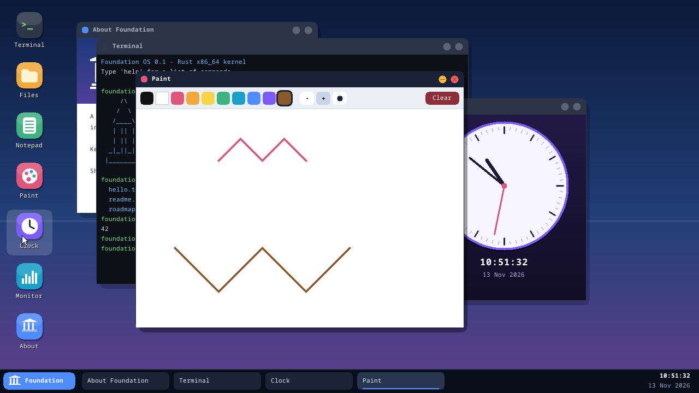
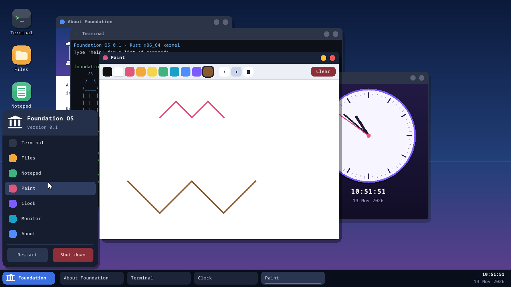
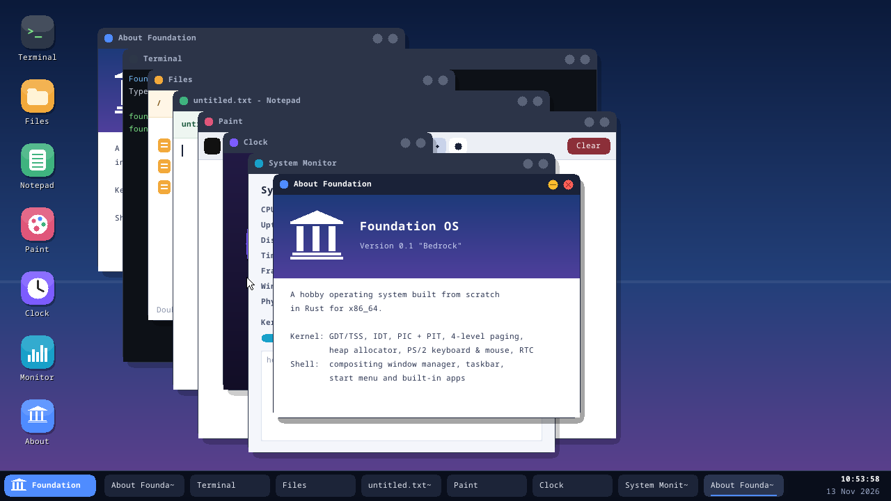

# Foundation OS

Foundation is an operating system project with two tracks:

| Track | What it is | Status |
|---|---|---|
| **[Foundation OS](linux/)** (`linux/`) | The everyday OS: Foundation desktop, store, package manager and installer on the Linux kernel (Ubuntu 24.04 LTS base). Runs Chrome, Microsoft 365, Google Drive, Flatpak apps and Windows `.exe`/`.msi` programs. | v0.2, installable ISO |
| **[Research kernel](research/)** (`research/`) | A from-scratch x86_64 kernel and GUI written in Rust - our own kernel, window manager and apps. | v0.1, boots in QEMU |

## Foundation OS (installable)

- **Bootable ISO** with a live session and a graphical installer (Calamares): BIOS + UEFI, ext4/btrfs/xfs, full-disk or manual partitioning.
- **Foundation desktop**: labwc compositor, Foundation taskbar and start menu, Foundation Store, Settings, welcome app.
- **`fpkg`**, one package manager for everything:
  - `fpkg install google-chrome` / `microsoft-365` / `google-drive` / `zoom` / ... (39-app catalog: vendor apt repos, Flathub, web apps)
  - `fpkg install setup.exe` / `installer.msi` - Windows programs, each in its own Wine "bottle", added to the menu
  - `fpkg pack setup.exe --name "My App" --args /S` - wrap any Windows installer as a `.fpkg` Foundation package
  - `fpkg install app.fpkg | file.deb | App.AppImage | flatpak:<id>`
  - `fpkg update` - OS, apps, Flatpaks and Foundation packages; security updates also install automatically
- **Networking**: NetworkManager (Ethernet, Wi-Fi, VPN), Bluetooth, PipeWire audio.
- **VM friendly**: guest tools for QEMU/KVM, VirtualBox and VMware.

See **[linux/README.md](linux/README.md)** for downloading the ISO, testing it in a VM and building it yourself.

## Research kernel



### What's in v0.1 "Bedrock"

**Kernel** (`research/kernel/`, `no_std` Rust)
- Boots via BIOS or UEFI (the [`bootloader`](https://crates.io/crates/bootloader) crate) into a linear framebuffer
- GDT + TSS with a dedicated double-fault stack, IDT with exception handlers
- 8259 PIC + PIT timer at 100 Hz, CMOS real-time clock
- 4-level paging, physical frame allocator, 48 MiB kernel heap
- PS/2 keyboard and mouse drivers (lock-free IRQ → main-loop queues)
- Serial console logging (COM1) and an in-memory kernel log (`dmesg`)
- FoundationFS: a flat in-memory filesystem

**Desktop shell**
- Compositing window manager: drag, focus, minimise, close, drop shadows
- Taskbar with window list and live clock, start menu with restart/shut down
- Desktop icons, anti-aliased text (Noto Sans Mono)

**Apps:** Terminal (20+ commands: `ls`, `cat`, `write`, `edit`, `open`, `neofetch`, `calc`, `dmesg`, ...), Files, Notepad, Paint, Clock, System Monitor, About.

| Start menu | Multitasking |
|---|---|
|  |  |

### Build and run

Requirements: [rustup](https://rustup.rs) (the pinned nightly toolchain installs automatically) and QEMU.

```bash
cd research
./run.sh          # build + boot in QEMU (BIOS)
./run.sh --uefi   # boot via OVMF instead
./build.sh        # only build target/foundation-{bios,uefi}.img
```

The disk images can also be written to a USB stick and booted on real hardware that supports PS/2 emulation (most PCs do for USB keyboards/mice via legacy mode).

### Layout

```
research/kernel/src/
  main.rs         entry point + main event loop
  gdt.rs          GDT/TSS
  interrupts.rs   IDT, PIC, PIT, IRQ handlers
  memory.rs       paging + frame allocator
  allocator.rs    kernel heap
  mouse.rs        PS/2 mouse
  rtc.rs          CMOS clock
  gfx.rs          canvas, primitives, text, framebuffer output
  wm.rs           window manager, taskbar, start menu
  apps.rs         built-in applications
  fs.rs           FoundationFS (in memory)
  sys.rs          system state, power, CPU info
research/builder/ turns the kernel ELF into bootable disk images
```

### Roadmap

- [ ] Preemptive scheduler and processes
- [ ] User mode + system calls, ELF loader
- [ ] AHCI/NVMe storage + persistent on-disk filesystem, installer
- [ ] Networking (virtio-net / e1000 + TCP/IP)
- [ ] Package format, app store and updates
