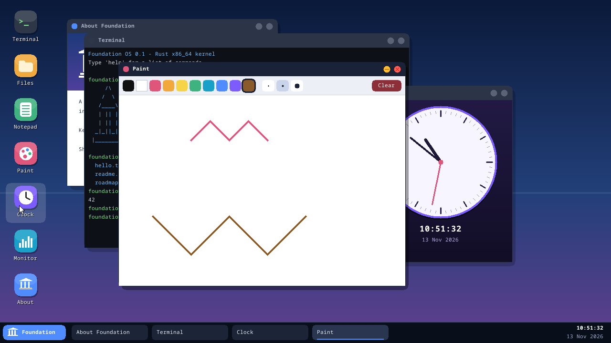
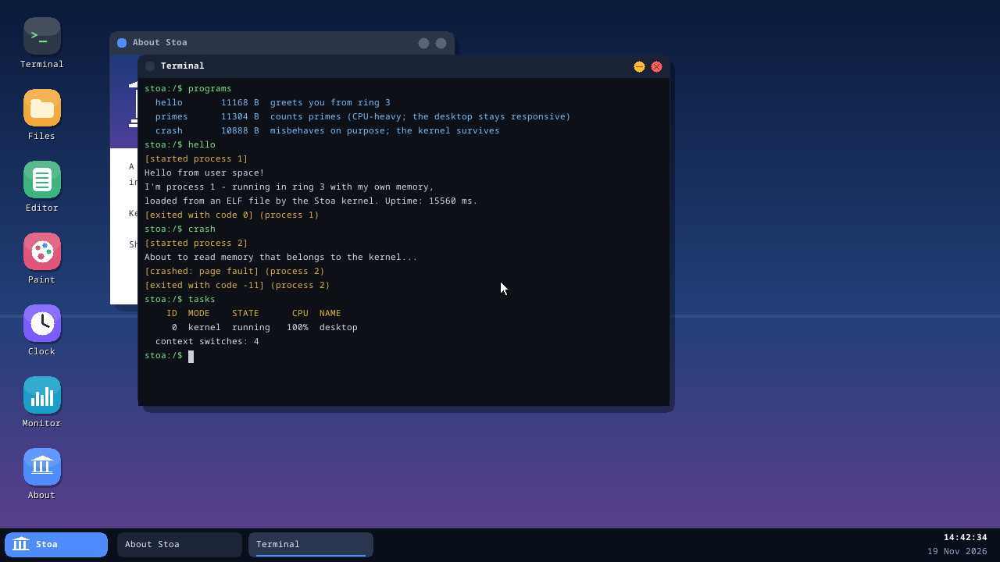
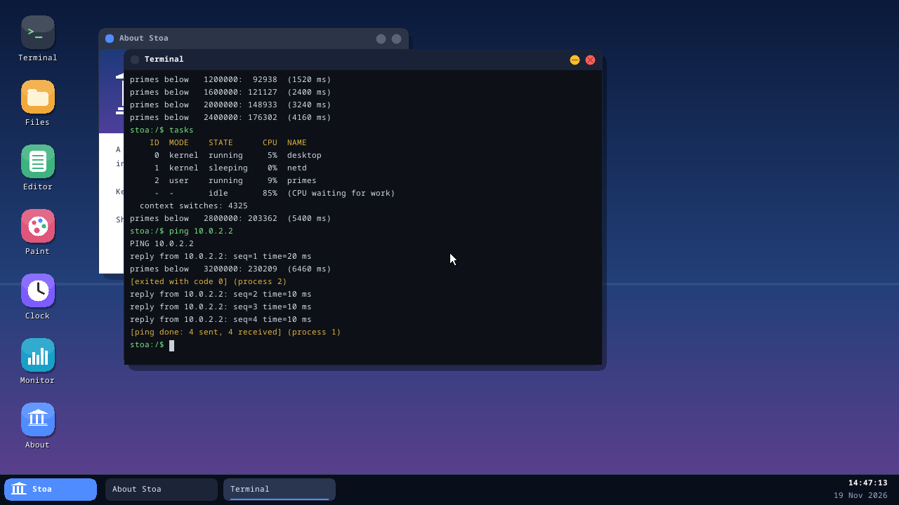
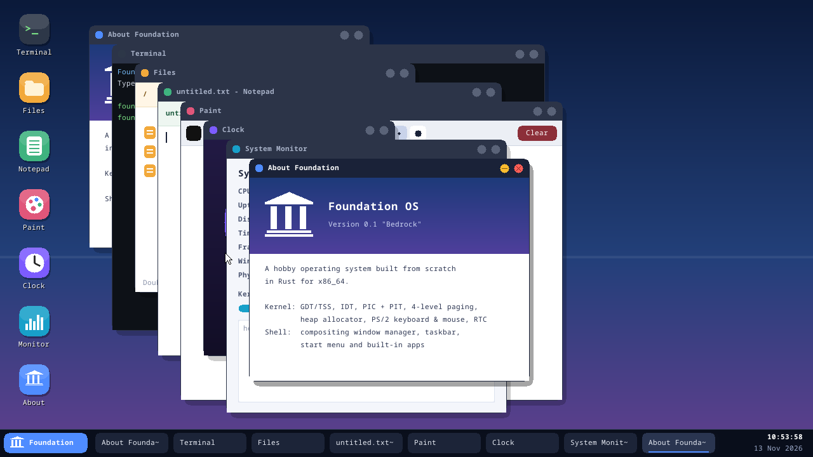

# Stoa

**The computer that builds what you need.**

A *stoa* was the covered colonnade at the heart of an ancient Greek city: a public place built to serve the
people inside it, where they met, traded and learned (the Stoic philosophers took their name from one in
Athens). Stoa the operating system has the same aim: a calm, trustworthy computer that works for the person
using it, and builds what they need when they ask.

Stoa has three tracks:

| Track | What it is | Status |
|---|---|---|
| **[Stoa](linux/)** (`linux/`) | The everyday OS: Stoa desktop, store, package manager and installer on the Linux kernel (Ubuntu 24.04 LTS base). Runs Chrome, Microsoft 365, Google Drive, Flatpak apps and Windows `.exe`/`.msi` programs. | v0.2, installable ISO |
| **[Stoa kernel](kernel/)** (`kernel/`) | Stoa's own Linux 7.0 build: desktop-tuned (full preemption, 1000 Hz, NTSYNC for Windows games, MGLRU, BBR), Stoa identity and boot screen, rebuilt weekly from Ubuntu's security-maintained HWE source. | Default kernel of Stoa |
| **[Research kernel](research/)** (`research/`) | A from-scratch x86_64 kernel and GUI written in Rust - our own kernel, drivers, filesystem, network stack, window manager and apps. | v0.2, boots in QEMU (BIOS + UEFI) |

## Stoa (installable)

- **Bootable ISO** with a live session and a graphical installer (Calamares): BIOS + UEFI, ext4/btrfs/xfs, full-disk or manual partitioning.
- **Stoa desktop**: labwc compositor, the Stoa bar and Stoa menu, Stoa Store, Settings, welcome app.
- **`fpkg`**, one package manager for everything:
  - `stoa install google-chrome` / `microsoft-365` / `google-drive` / `zoom` / ... (130+ app catalog: vendor apt repos, Flathub, web apps, game set-ups)
  - `stoa install setup.exe` / `installer.msi` - Windows programs, each in its own Wine "bottle", added to the menu
  - `stoa pack setup.exe --name "My App" --args /S` - wrap any Windows installer as a `.fpkg` Stoa package
  - `stoa install app.fpkg | file.deb | App.AppImage | flatpak:<id>`
  - `stoa update` - OS, apps, Flatpaks and Stoa packages; security updates also install automatically
- **Networking**: NetworkManager (Ethernet, Wi-Fi, VPN), Bluetooth, PipeWire audio.
- **VM friendly**: guest tools for QEMU/KVM, VirtualBox and VMware.

See **[linux/README.md](linux/README.md)** for downloading the ISO, testing it in a VM and building it yourself.

## Research kernel



### What's in v0.2 "Agora"

**Kernel** (`research/kernel/`, `no_std` Rust, no Linux code)
- Boots via BIOS or UEFI (the [`bootloader`](https://crates.io/crates/bootloader) crate) into a linear framebuffer
- GDT + TSS (per-task kernel stacks), IDT with exception handlers, 8259 PIC + PIT at 100 Hz, CMOS clock
- 4-level paging, physical frame allocator with reuse, 48 MiB kernel heap, MMIO mapping for devices
- **Preemptive multitasking**: round-robin scheduler switching kernel threads and processes on every timer
  tick, sleeping tasks, idle accounting (`tasks`)
- **User mode**: ring-3 processes, each in its own address space, loaded from **ELF** executables; system
  calls over `int 0x80` (write, exit, yield, time, getpid, sleep); a crashing program is ended and the
  system carries on
- **Drivers**: PCI bus enumeration, ATA/IDE disks (PIO), Intel e1000 Ethernet (DMA rings), PS/2 keyboard and
  mouse, COM1 serial log
- **StoaFS**: Stoa's own on-disk filesystem (superblock, 128-entry directory, contiguous extents). Files
  survive reboots; it only ever formats a completely blank disk
- **Networking**: Ethernet, ARP, IPv4, ICMP (ping out, answers pings), UDP and a **DHCP client**, in a
  `netd` kernel thread

**User programs** (`research/user/`): `libstoa` (system calls, `println!`) and `/bin` programs - `hello`,
`primes` (CPU-heavy, runs alongside the desktop), `crash` (proves isolation).

| Programs in ring 3 | Network + multitasking |
|---|---|
|  |  |

**Desktop shell**
- Compositing window manager: drag, focus, minimise, close, drop shadows
- Taskbar with window list and live clock, start menu with restart/shut down
- Desktop icons, anti-aliased text (Noto Sans Mono)

**Apps:** Terminal (30+ commands: `ls`, `cat`, `write`, `edit`, `run`, `tasks`, `kill`, `lspci`, `lsblk`, `df`,
`ifconfig`, `ping`, `arp`, `neofetch`, `dmesg`, ...), Files, Editor, Paint, Clock, System Monitor, About.

| Start menu | Multitasking |
|---|---|
|  |  |

### Build and run

Requirements: [rustup](https://rustup.rs) (the pinned nightly toolchain installs automatically) and QEMU.

```bash
cd research
./run.sh          # build + boot in QEMU (BIOS), with a data disk for StoaFS and networking
./run.sh --uefi   # boot via OVMF instead
./build.sh        # only build target/stoa-{bios,uefi}.img
```

The disk images can also be written to a USB stick and booted on real hardware that supports PS/2 emulation (most PCs do for USB keyboards/mice via legacy mode).

### Layout

```
research/kernel/src/
  main.rs         entry point + main event loop
  gdt.rs          GDT/TSS
  interrupts.rs   IDT, PIC, PIT, IRQ handlers
  memory.rs       paging, frame allocator, MMIO, per-process address spaces
  allocator.rs    kernel heap
  sched.rs        scheduler, context switching, ELF loader, system calls
  pci.rs          PCI enumeration
  ata.rs          ATA/IDE disk driver
  e1000.rs        Intel e1000 network driver
  net.rs          ARP, IPv4, ICMP, UDP, DHCP (netd thread)
  programs.rs     /bin: user programs embedded in the kernel
  mouse.rs        PS/2 mouse
  rtc.rs          CMOS clock
  gfx.rs          canvas, primitives, text, framebuffer output
  wm.rs           window manager, taskbar, start menu
  apps.rs         built-in applications
  fs.rs           StoaFS (on disk)
  sys.rs          system state, power, CPU info
research/user/    libstoa + user programs (ring 3)
research/builder/ turns the kernel ELF into bootable disk images
```

### Roadmap

- [ ] Preemptive scheduler and processes
- [ ] User mode + system calls, ELF loader
- [ ] AHCI/NVMe storage + persistent on-disk filesystem, installer
- [ ] Networking (virtio-net / e1000 + TCP/IP)
- [ ] Package format, app store and updates
