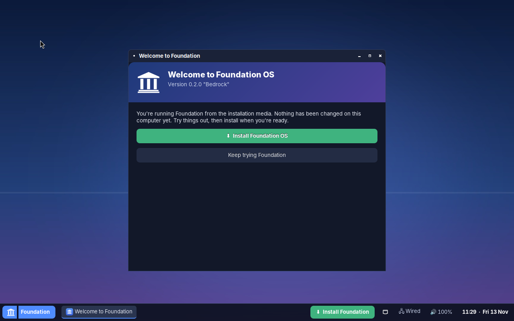
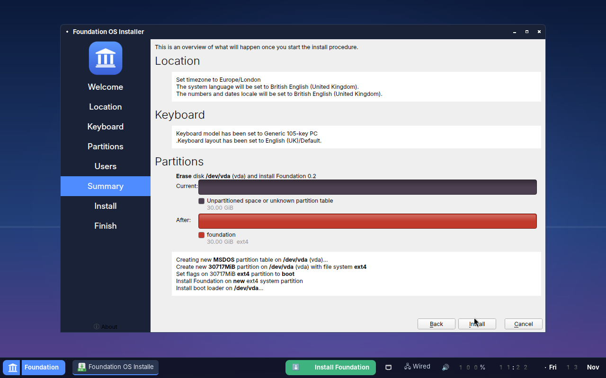
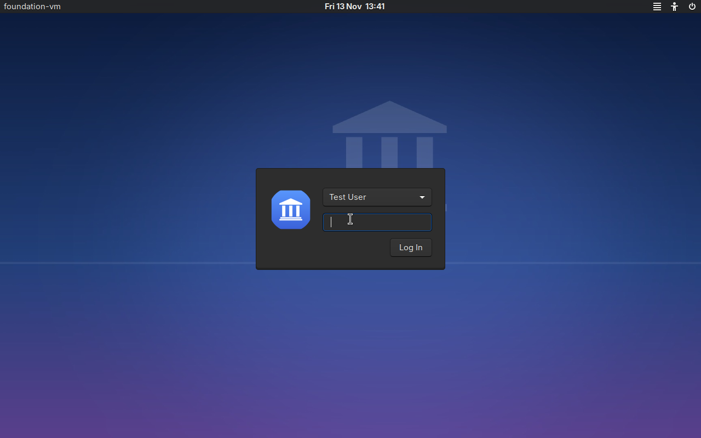
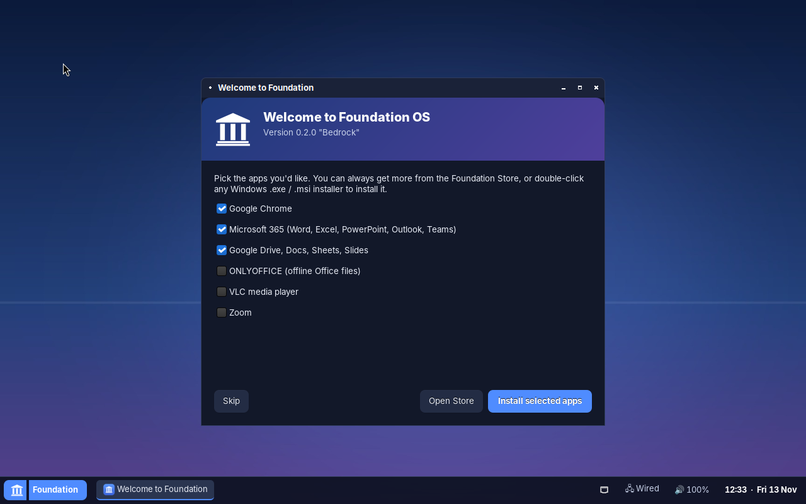
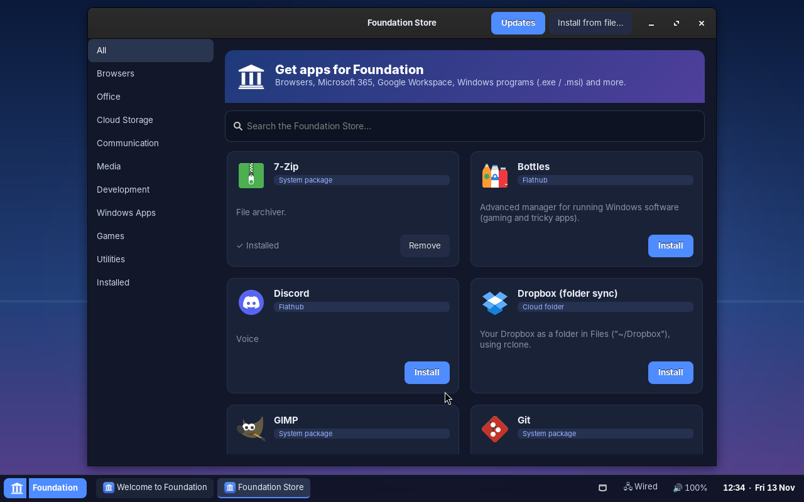
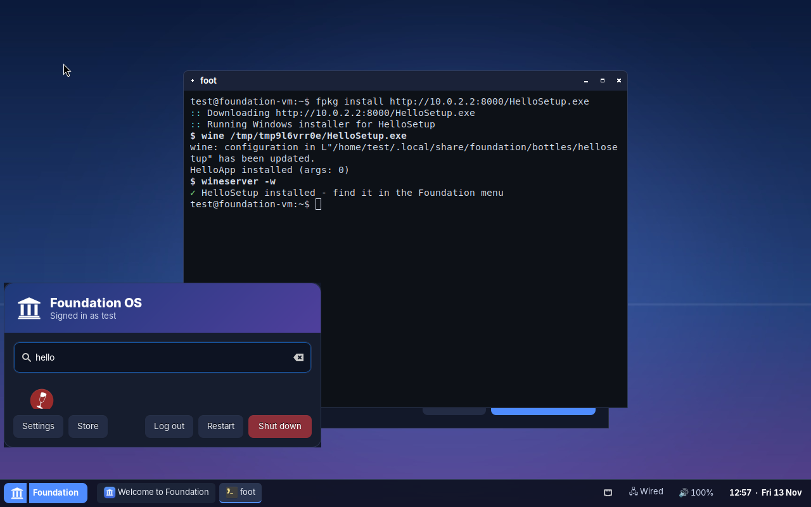

# Foundation OS (Linux edition)

The installable, everyday Foundation OS: the Foundation desktop and tools on top of the Linux kernel
(Ubuntu 24.04 LTS base, so you get its hardware support, drivers and security updates).

| Live session | Installer | Installed: login |
|---|---|---|
|  |  |  |
| **First run** | **Foundation Store** | **Windows app installed with fpkg** |
|  |  |  |

## Get the ISO

GitHub builds the ISO automatically:

1. Open **Actions → Build Foundation OS ISO** in this repository (or run it with **Run workflow**).
2. Open the latest successful run and download the **foundation-os-iso** artifact (a zip containing
   `foundation-<version>-amd64.iso` and its `.sha256`).
3. Pushing a tag like `v0.2.0` also publishes the ISO on the Releases page.

## Test it in a virtual machine

Give the VM **4 GB RAM (2 GB minimum), 2+ CPUs and a 25 GB+ disk**, attach the ISO as a CD/DVD, and boot it.
Choose **Try or Install Foundation OS**, then click **Install Foundation** on the taskbar or welcome screen.

| Hypervisor | Notes |
|---|---|
| **VirtualBox** | Type *Linux / Ubuntu (64-bit)*, 128 MB video memory. Graphics controller **VBoxVGA** is the most reliable; VMSVGA also works. Leave *View → Auto-resize Guest Display* on and Foundation follows the window size. |
| **VMware Workstation/Player/Fusion** | Guest OS *Ubuntu 64-bit*. |
| **Hyper-V** | Generation 2 VM: **turn off Secure Boot** (Settings → Security) - the v0.2 bootloader is not signed yet. Generation 1 also works. |
| **QEMU/KVM, virt-manager, GNOME Boxes, UTM (Intel Macs)** | `qemu-system-x86_64 -enable-kvm -m 4G -smp 2 -cdrom foundation-*.iso -drive file=disk.qcow2,if=virtio` |
| **Real PC** | Write the ISO to a USB stick with balenaEtcher or Rufus (DD mode). Disable Secure Boot. |

After installation remove the ISO and reboot; you'll get the Foundation login screen, then the welcome
app offers one-click installs of Google Chrome, Microsoft 365 and Google Drive.

## Installing software

Everything goes through **`fpkg`** (the Foundation Store is a graphical front end to it):

```bash
fpkg search office
fpkg install google-chrome microsoft-365 google-drive
fpkg install ~/Downloads/SomeSetup.exe      # Windows installer, own Wine bottle, added to the menu
fpkg install ~/Downloads/Product.msi
fpkg install flatpak:org.gimp.GIMP
fpkg install ./package.deb  ./App.AppImage
fpkg list
fpkg remove zoom
fpkg update                                  # OS + apps + Flatpaks + Foundation packages
```

Double-clicking an `.exe`, `.msi`, `.fpkg`, `.deb` or AppImage in **Files** opens the Foundation App Installer.

### What runs, honestly

| Software | How it runs on Foundation |
|---|---|
| Google Chrome, Microsoft Edge, Firefox, VS Code | Official Linux builds from the vendors' own repositories (auto-updated) |
| Microsoft 365 (Word, Excel, PowerPoint, Outlook, OneNote, Teams) | Full Microsoft 365 web apps in their own windows. Microsoft does not make desktop Office for Linux; desktop Office under Wine is unreliable, so it isn't offered. ONLYOFFICE/LibreOffice are offline alternatives with good Office file compatibility. |
| Google Drive | Drive/Docs/Sheets/Slides apps, plus optional `~/Google Drive` folder sync (`fpkg install google-drive-sync`) |
| OneDrive, Dropbox | Folder sync via rclone (`onedrive-sync`, `dropbox-sync`) |
| Zoom, Slack, Spotify, Discord, Steam, OBS... | Flathub |
| Other Windows `.exe` / `.msi` programs | Wine 9 (64- and 32-bit). Many apps work; apps with kernel drivers, anti-cheat or deep Windows integration won't. For tricky apps install **Bottles** from the Store. |

### Foundation packages (`.fpkg`)

A `.fpkg` is a gzip'd tar with an `fpkg.json` manifest and a `payload/` folder. It lets you package a
Windows installer (or a native Linux app) with everything needed to install it silently, an icon and an
update feed:

```bash
fpkg pack npp.8.6.Installer.x64.exe --name "Notepad++" --version 8.6 --args "/S" \
     --exec "C:/Program Files/Notepad++/notepad++.exe" --icon npp.png \
     --update-url https://example.com/notepadpp/latest.json
fpkg install notepad-8.6.fpkg
```

`update-url` points to a JSON document `{"version": "8.7", "url": "https://.../notepadpp-8.7.fpkg"}`;
`fpkg update` installs newer versions automatically.

Manifest fields: `id`, `name`, `version`, `type` (`windows` | `native` | `webapp`), `description`,
`installer`, `args`, `exec`, `arch` (`win64`/`win32`), `winetricks` (list of verbs), `portable`, `icon`,
`update_url`, `url` (web apps).

## Updates

- Security updates install automatically in the background (unattended-upgrades).
- A timer refreshes update information twice a day; the taskbar shows **⬆ N** when updates are waiting.
  Click it (or run `fpkg update`) to install everything: OS packages, vendor apps (Chrome, Edge...),
  Flatpaks and `.fpkg` packages.

## Build the ISO yourself

On Ubuntu 24.04 (or in the GitHub workflow):

```bash
sudo apt install mmdebstrap squashfs-tools xorriso grub-pc-bin grub-efi-amd64-bin mtools
sudo ./build-iso.sh              # -> out/foundation-<version>-amd64.iso
sudo ./build-iso.sh customize    # re-apply overlay/ to the cached root filesystem
sudo ./build-iso.sh iso          # repack only
```

| Path | Purpose |
|---|---|
| `packages.txt` | Package set of the OS |
| `overlay/` | Foundation's own files, copied over the root filesystem |
| `setup-rootfs.sh` | Configuration run inside the root filesystem (branding, services, live user) |
| `iso/grub.cfg` | ISO boot menu |
| `overlay/etc/calamares/` | Installer configuration and branding |
| `overlay/usr/bin/fpkg`, `overlay/usr/lib/foundation/fpkg-helper` | Package manager (user part / privileged part) |
| `overlay/usr/share/foundation/catalog.yaml` | Store catalog |
| `overlay/usr/bin/foundation-*` | Launcher, Store, Settings, Welcome, App Installer, session |
| `tools/make-assets.py` | Regenerates logo, icons and wallpaper |

## Tested

Each release is install-tested in QEMU: boot ISO → live desktop → Calamares install (BIOS, erase disk,
ext4) → reboot from disk → graphical login → Foundation Store install (VLC) with polkit authentication →
Windows `.exe` installed via `fpkg` into a Wine bottle and listed in the start menu.

## Known issues (v0.2)

- If the graphics card has no Linux kernel driver (or you boot *safe graphics*), Foundation starts in
  **compatibility graphics** mode: the same desktop running inside a basic Xorg display. It works, but is
  slower and can't change resolution; pick another VM graphics controller for best results.
- Session problems are logged to `~/.cache/foundation-session.log`.

- Not Secure Boot signed yet: disable Secure Boot (Hyper-V Gen 2, most PCs).
- On BIOS installs the `grub-pc` package is not added, so GRUB itself isn't upgraded by package updates
  (kernel updates still regenerate the boot menu).
- In QEMU without KVM, use a named CPU model (e.g. `-cpu Nehalem`), not `-cpu max`: Wine crashes on
  the emulated experimental CPU features.
- Google Chrome/Edge/Flathub installs need internet access to those vendors' servers.

## Roadmap

- Signed bootloader (Secure Boot)
- Btrfs snapshots before every update, with rollback from the boot menu
- Foundation's own apt repository so Foundation components update like everything else
- Graphical Settings for displays, users and printers
- Built-in browser choice on first boot
