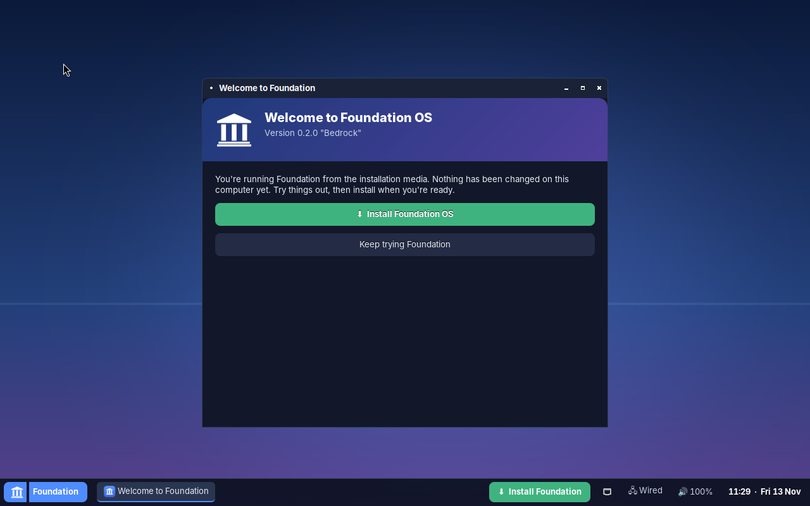
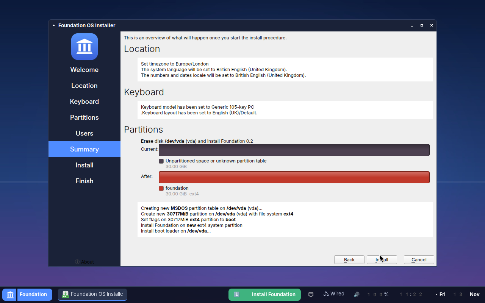
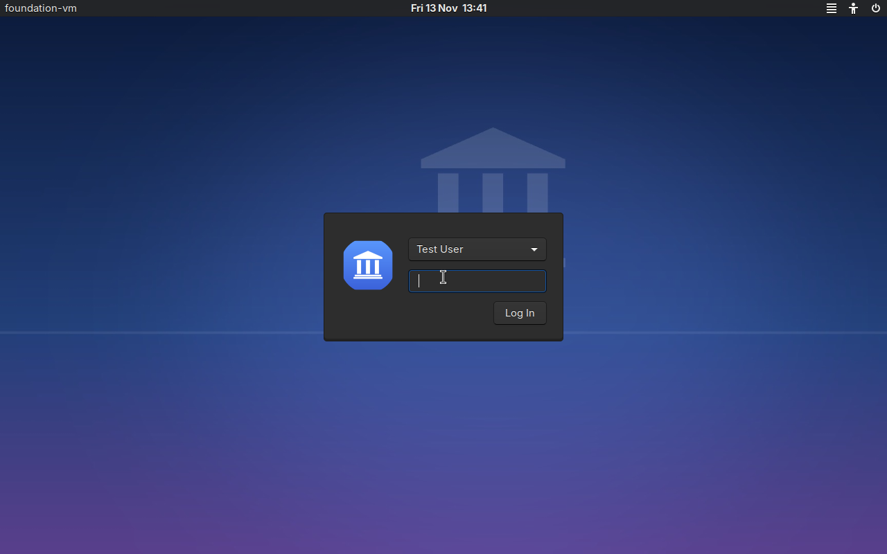
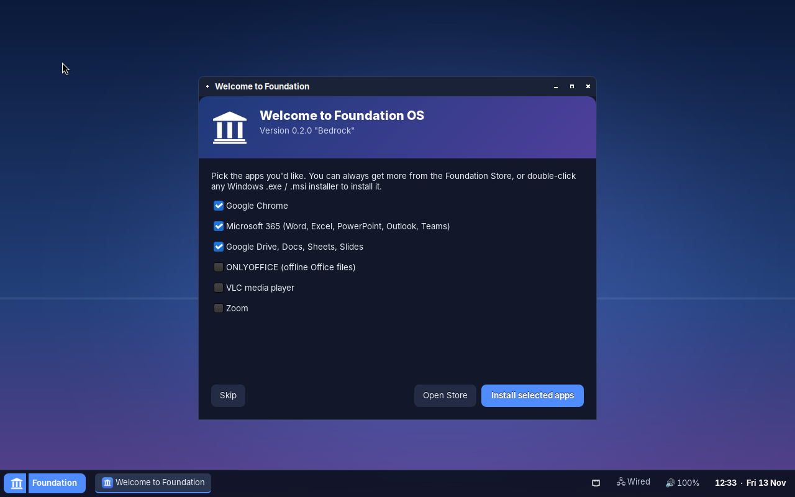
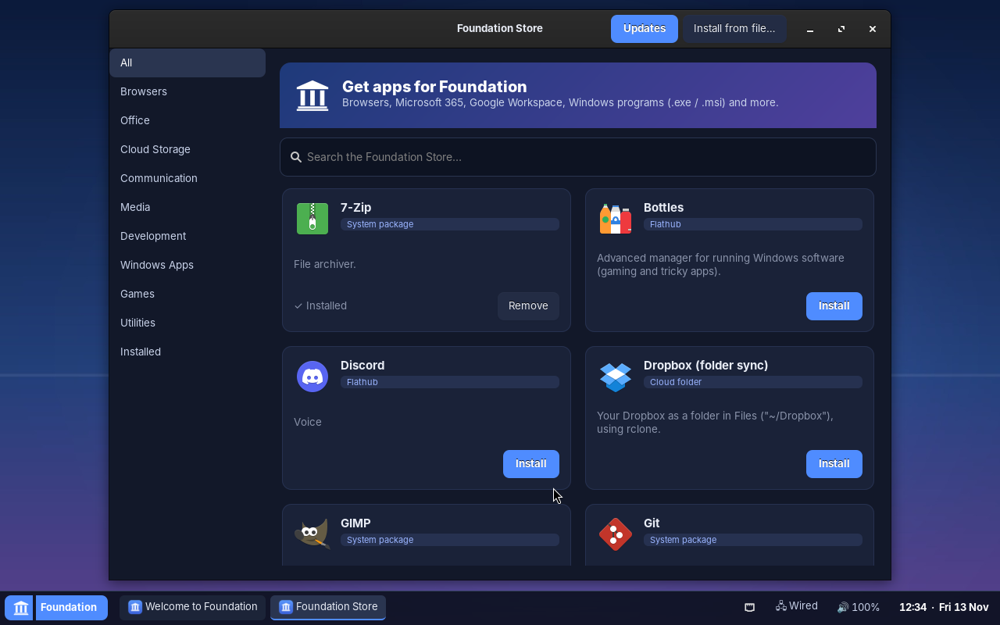
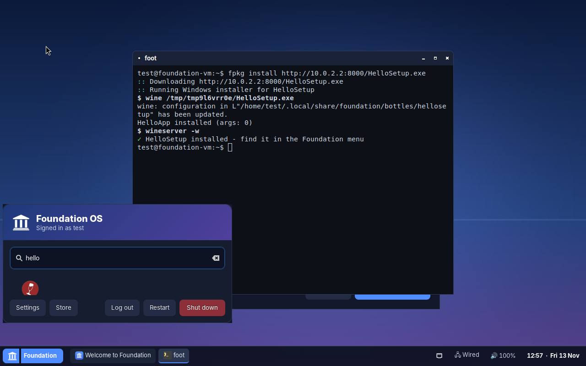

# Stoa (Linux edition)

The installable, everyday Stoa: the Stoa desktop and tools on top of the Linux kernel
(Ubuntu 24.04 LTS base, so you get its hardware support, drivers and security updates).

| Live session | Installer | Installed: login |
|---|---|---|
|  |  |  |
| **First run** | **Stoa Store** | **Windows app installed with fpkg** |
|  |  |  |

## Get the ISO

GitHub builds the ISO automatically:

1. Open **Actions → Build Stoa ISO** in this repository (or run it with **Run workflow**).
2. Open the latest successful run and download the **stoa-os-iso** artifact (a zip containing
   `stoa-<version>-amd64.iso` and its `.sha256`).
3. Pushing a tag like `v0.2.0` also publishes the ISO on the Releases page.

## Test it in a virtual machine

Give the VM **4 GB RAM (2 GB minimum), 2+ CPUs and a 25 GB+ disk**, attach the ISO as a CD/DVD, and boot it.
Choose **Try or Install Stoa**, then click **Install Stoa** on the taskbar or welcome screen.

| Hypervisor | Notes |
|---|---|
| **VirtualBox** | Type *Linux / Ubuntu (64-bit)*, 128 MB video memory. Graphics controller **VBoxVGA** is the most reliable; VMSVGA also works. Leave *View → Auto-resize Guest Display* on and Stoa follows the window size. |
| **VMware Workstation/Player/Fusion** | Guest OS *Ubuntu 64-bit*. |
| **Hyper-V** | Generation 2 VM: **turn off Secure Boot** (Settings → Security) - the v0.2 bootloader is not signed yet. Generation 1 also works. |
| **QEMU/KVM, virt-manager, GNOME Boxes, UTM (Intel Macs)** | `qemu-system-x86_64 -enable-kvm -m 4G -smp 2 -cdrom stoa-*.iso -drive file=disk.qcow2,if=virtio` |
| **Real PC** | Write the ISO to a USB stick with balenaEtcher or Rufus (DD mode). Disable Secure Boot. |

After installation remove the ISO and reboot; you'll get the Stoa login screen, then the welcome
app offers one-click installs of Google Chrome, Microsoft 365 and Google Drive.

## Stoa Shell

Stoa's desktop is its own: **Stoa Shell** (`overlay/usr/bin/stoa-shell`,
`overlay/usr/lib/stoa/shell/`) on the labwc compositor, with Windows-familiar conventions:

- **Desktop** with This PC, Documents, Recycle Bin, Stoa Store and your Desktop folder; right-click for
  New folder / New text document / Display settings / Personalise.
- **Taskbar**: Start and Search on the left, pinned and running apps in the centre (click to switch or minimise,
  middle-click for a new window, right-click to pin or close), Quick Settings and the clock on the right.
- **Start menu**: search, pinned apps, All apps A–Z, Recommended (recent files), account and power.
- **Quick Settings**: Wi-Fi with network picker, Bluetooth, Airplane mode, volume, brightness, battery.
- **Familiar names**: File Explorer, Notepad, Photos, Task Manager, PDF Reader, Terminal.
- `stoa-toplevels` (Rust, `shell/toplevels/`) feeds the taskbar the list of open windows.

| Shortcut | Action |
|---|---|
| Win+Space or Ctrl+Esc | Start |
| Win+S | Search |
| Win+E | File Explorer |
| Win+R | Run |
| Win+I | Settings |
| Win+A | Quick Settings |
| Win+L | Lock |
| Ctrl+Shift+Esc | Task Manager |
| Win+Shift+S / Print | Screenshot (area / full) |
| Win+←/→/↑/↓ | Snap left/right, maximise, minimise |
| Alt+Tab, Alt+F4 | Switch / close windows |

## Stoa AI

Stoa AI (taskbar ✦ button, **Win+C**, or Start) is an assistant built into the OS, powered by Claude
(`claude-opus-5-5` through the Anthropic API). Ask for what you need and it does it:

- **Builds apps on the spot.** "Make me a budget tracker", "build a Pomodoro timer", "I need a flashcard app
  for French verbs" - you watch it being written, it opens as soon as it's ready, and it's added to Start.
  Ask for changes ("make the buttons bigger") and it updates the app. Apps are single HTML files run in a
  sandboxed web view (`stoa-ai-app`): they keep their own data and can't read your files.
- **Installs software** from the Stoa Store, Flathub, apt or a downloaded .exe/.msi - always after you
  approve, with your password where needed.
- **Opens apps, changes settings** (volume, Wi-Fi, Bluetooth, airplane mode, brightness) and answers
  questions about your system.

Setup: paste an Anthropic API key (from console.anthropic.com) when you first open it. The key is stored in
`~/.config/stoa/assistant.json` (readable only by you); `ANTHROPIC_API_KEY` also works. What you type
is sent to Anthropic to generate replies. Server-side model fallback is enabled, so a request one model
declines can be answered by another.

Code: `overlay/usr/lib/stoa/assistant/agent.py` (agent loop and tools),
`overlay/usr/bin/stoa-assistant` (panel), `overlay/usr/bin/stoa-ai-app` (app runner).

## Installing software

Everything goes through **`fpkg`** (the Stoa Store is a graphical front end to it):

```bash
stoa search office
stoa install google-chrome microsoft-365 google-drive
stoa install ~/Downloads/SomeSetup.exe      # Windows installer, own Wine bottle, added to the menu
stoa install ~/Downloads/Product.msi
stoa install flatpak:org.gimp.GIMP
stoa install ./package.deb  ./App.AppImage
stoa list
stoa remove zoom
stoa update                                  # OS + apps + Flatpaks + Stoa packages
```

Double-clicking an `.exe`, `.msi`, `.fpkg`, `.deb` or AppImage in **Files** opens the Stoa App Installer.

### What runs, honestly

| Software | How it runs on Stoa |
|---|---|
| Google Chrome, Microsoft Edge, Firefox, VS Code | Official Linux builds from the vendors' own repositories (auto-updated) |
| Microsoft 365 (Word, Excel, PowerPoint, Outlook, OneNote, Teams) | Full Microsoft 365 web apps in their own windows. Microsoft does not make desktop Office for Linux; desktop Office under Wine is unreliable, so it isn't offered. ONLYOFFICE/LibreOffice are offline alternatives with good Office file compatibility. |
| Google Drive | Drive/Docs/Sheets/Slides apps, plus optional `~/Google Drive` folder sync (`stoa install google-drive-sync`) |
| OneDrive, Dropbox | Folder sync via rclone (`onedrive-sync`, `dropbox-sync`) |
| Zoom, Slack, Spotify, Discord, Steam, OBS... | Flathub |
| Other Windows `.exe` / `.msi` programs | Wine 9 (64- and 32-bit). Many apps work; apps with kernel drivers, anti-cheat or deep Windows integration won't. For tricky apps install **Bottles** from the Store. |

### Stoa packages (`.fpkg`)

A `.fpkg` is a gzip'd tar with an `fpkg.json` manifest and a `payload/` folder. It lets you package a
Windows installer (or a native Linux app) with everything needed to install it silently, an icon and an
update feed:

```bash
stoa pack npp.8.6.Installer.x64.exe --name "Notepad++" --version 8.6 --args "/S" \
     --exec "C:/Program Files/Notepad++/notepad++.exe" --icon npp.png \
     --update-url https://example.com/notepadpp/latest.json
stoa install notepad-8.6.fpkg
```

`update-url` points to a JSON document `{"version": "8.7", "url": "https://.../notepadpp-8.7.fpkg"}`;
`stoa update` installs newer versions automatically.

Manifest fields: `id`, `name`, `version`, `type` (`windows` | `native` | `webapp`), `description`,
`installer`, `args`, `exec`, `arch` (`win64`/`win32`), `winetricks` (list of verbs), `portable`, `icon`,
`update_url`, `url` (web apps).

## Updates

- Security updates install automatically in the background (unattended-upgrades).
- A timer refreshes update information twice a day; the taskbar shows **⬆ N** when updates are waiting.
  Click it (or run `stoa update`) to install everything: OS packages, vendor apps (Chrome, Edge...),
  Flatpaks and `.fpkg` packages.

## Build the ISO yourself

On Ubuntu 24.04 (or in the GitHub workflow):

```bash
sudo apt install mmdebstrap squashfs-tools xorriso grub-pc-bin grub-efi-amd64-bin mtools python3-pip cargo
sudo ./build-iso.sh              # -> out/stoa-<version>-amd64.iso
sudo ./build-iso.sh customize    # re-apply overlay/ to the cached root filesystem
sudo ./build-iso.sh iso          # repack only
```

| Path | Purpose |
|---|---|
| `packages.txt` | Package set of the OS |
| `overlay/` | Stoa's own files, copied over the root filesystem |
| `setup-rootfs.sh` | Configuration run inside the root filesystem (branding, services, live user) |
| `iso/grub.cfg` | ISO boot menu |
| `overlay/etc/calamares/` | Installer configuration and branding |
| `overlay/usr/bin/fpkg`, `overlay/usr/lib/stoa/fpkg-helper` | Package manager (user part / privileged part) |
| `overlay/usr/share/stoa/catalog.yaml` | Store catalog |
| `overlay/usr/bin/stoa-*` | Launcher, Store, Settings, Welcome, App Installer, session |
| `tools/make-assets.py` | Regenerates the circular Stoa emblem, icons and wallpaper |

## Tested

Each release is install-tested in QEMU: boot ISO → live desktop → Calamares install (BIOS, erase disk,
ext4) → reboot from disk → graphical login → Stoa Store install (VLC) with polkit authentication →
Windows `.exe` installed via `fpkg` into a Wine bottle and listed in the start menu.

## Known issues (v0.2)

- If the graphics card has no Linux kernel driver (or you boot *safe graphics*), Stoa starts in
  **compatibility graphics** mode: the same desktop running inside a basic Xorg display. It works, but is
  slower and can't change resolution; pick another VM graphics controller for best results.
- Session problems are logged to `~/.cache/stoa-session.log`.

- Not Secure Boot signed yet: disable Secure Boot (Hyper-V Gen 2, most PCs).
- On BIOS installs the `grub-pc` package is not added, so GRUB itself isn't upgraded by package updates
  (kernel updates still regenerate the boot menu).
- In QEMU without KVM, use a named CPU model (e.g. `-cpu Nehalem`), not `-cpu max`: Wine crashes on
  the emulated experimental CPU features.
- Google Chrome/Edge/Flathub installs need internet access to those vendors' servers.

## Roadmap

- Signed bootloader (Secure Boot)
- Btrfs snapshots before every update, with rollback from the boot menu
- Stoa's own apt repository so Stoa components update like everything else
- Graphical Settings for displays, users and printers
- Built-in browser choice on first boot
